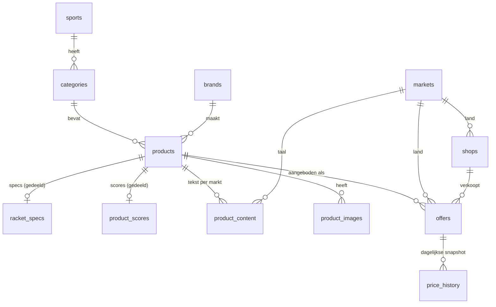

# Databaseschema

Supabase-project `racketpicker` (Frankfurt). Migraties staan in `supabase/migrations/`.

## Overzicht

## Tabellen

| Tabel             | Wat                                                                                          | Gedeeld of per markt |
| ----------------- | -------------------------------------------------------------------------------------------- | -------------------- |
| `markets`         | nl, es (`is_active` volgt `NEXT_PUBLIC_ACTIVE_LOCALES`)                                      | n.v.t.               |
| `sports`          | padel, tennis                                                                                | gedeeld              |
| `categories`      | padel-rackets, -shoes, -bags, -balls. Publieke slugs per taal staan in `src/i18n/routing.ts` | gedeeld              |
| `brands`          | merken met slug en logo                                                                      | gedeeld              |
| `products`        | merk, model, jaar, GTIN's, tier (A/B/C), status, `is_sample`                                 | gedeeld              |
| `racket_specs`    | vorm, gewicht (min/max), balans, kern, slagvlak, frame, ruwheid, dikte, niveaus, speelstijl  | gedeeld              |
| `product_scores`  | power, controle, sweetspot, wendbaarheid, comfort (0–100) + **bron** (specs/test/redactie)   | gedeeld              |
| `product_content` | slug, titel, SEO, intro, sterk in / let op / ideaal voor, FAQ                                | per markt            |
| `product_images`  | pad in Supabase Storage, alt, volgorde                                                       | gedeeld              |
| `shops`           | winkel, land, affiliate-netwerk (Daisycon/Awin), verzendinfo                                 | per markt            |
| `offers`          | product × winkel: prijs incl. btw, verzendkosten, voorraad, levertijd, affiliate-link        | per markt            |
| `price_history`   | één snapshot per offer per dag                                                               | per markt            |

**View** `product_price_summary`: laagste prijs, laagste totaalprijs (incl. verzending), aantal winkels en aantal op voorraad per product per markt. Draait met `security_invoker`, dus alleen zichtbare offers tellen mee.

## Afspraken

- **Prijzen** zijn `numeric(10,2)` in EUR incl. btw; verzendkosten apart.
- **Slugs** zijn uniek per markt (`product_content (market_code, slug)`).
- **Scores** zijn nooit verzonnen: elke set heeft een `source` en optioneel een `method_note`.
- **Voorbeelddata** heeft `is_sample = true`. De app filtert dit in productie weg (RLS kan geen omgeving zien).
- **`updated_at`** wordt automatisch bijgewerkt via een trigger.

## Voorbeelddata (seed)

`supabase/seed.sql` vult 10 voorbeeldrackets (Adidas 2026-lijn en Kuikma Carbon 26) met specs, scores, NL-teksten, 2–4 winkelaanbiedingen per racket en 90 dagen prijshistorie. Twee rackets zijn Tier A (met FAQ), zes Tier B en twee Tier C, zodat alle varianten van de productpagina te testen zijn.

- **Opnieuw draaien kan altijd**: het script verwijdert eerst alle `is_sample`-producten (inclusief aanbod en prijshistorie) en vult ze dan opnieuw. Merken en winkels worden bijgewerkt, niet gedupliceerd.
- Draaien: `npm run db:seed` (met `SUPABASE_DB_URL`) of plak het bestand in de SQL-editor van Supabase.
- Productnamen volgen de echte lijnen, maar **specs, scores, prijzen en teksten zijn voorbeelden**. Scores hebben de notitie "Voorbeeldwaarden voor ontwikkeling, niet gemeten".
- De app toont voorbeelddata alleen als `NEXT_PUBLIC_SHOW_SAMPLE_DATA=true` (Preview/Development). Elke catalogusquery gebruikt `withoutSamples()` uit `src/lib/catalog/sample-data.ts`.

## Beveiliging (RLS)

Alle tabellen hebben RLS. Tabellen worden niet automatisch via de API gepubliceerd: `anon` en `authenticated` krijgen alleen expliciet `SELECT`. Schrijven gebeurt server-side met de secret key (feed-import, cron), die RLS omzeilt.

| Publiek zichtbaar                   | Voorwaarde                                         |
| ----------------------------------- | -------------------------------------------------- |
| sports, categories, brands, markets | altijd                                             |
| products, specs, scores, images     | product `status = 'published'`                     |
| product_content                     | `is_published` én product gepubliceerd             |
| shops                               | `is_active`                                        |
| offers                              | `is_active`, product gepubliceerd én winkel actief |
| price_history                       | de bijbehorende offer is zichtbaar                 |

Getest op 4 nov 2026: drafts, inactieve winkels en hun offers zijn onzichtbaar voor `anon`, ook in `product_price_summary`; `anon` kan niets schrijven. Security advisor: 0 meldingen.
