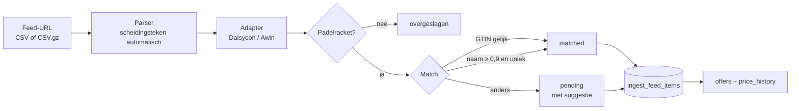

# Feed-import (Daisycon & Awin)

Productfeeds van affiliatewinkels worden ingelezen, gefilterd, gekoppeld aan producten in onze catalogus en omgezet in `offers` met dagelijkse prijshistorie.



## Onderdelen

| Bestand                                 | Wat                                                                               |
| --------------------------------------- | --------------------------------------------------------------------------------- |
| `src/lib/feeds/csv.ts`                  | Leest CSV (ook gzip), herkent `,` `;` tab en `\|` automatisch                     |
| `src/lib/feeds/adapters.ts`             | Kolomnamen per netwerk → één genormaliseerd formaat                               |
| `src/lib/feeds/normalize.ts`            | Prijzen (`96,74` / `1.299,00`), GTIN, voorraad, levertijd                         |
| `src/lib/feeds/filter.ts`               | Houdt padelrackets over, of rackets en tassen (`classifyItem`, RP-91)             |
| `src/lib/feeds/match.ts`                | Koppelt aan een product: eerst GTIN, dan naam (merk + model + jaar)               |
| `src/lib/feeds/feed-discovery.ts`       | Nieuwe producten uit een feed (RP-91), opslaan via `create-products.ts`           |
| `src/lib/feeds/pipeline.ts`             | Pure stap: bytes → items met match. Geen netwerk of database                      |
| `src/lib/feeds/run-import.ts`           | Download, catalogus laden, veiligheidscheck, `ingest_feed_items()`, `import_runs` |
| `scripts/import-feed.ts`                | CLI: `npm run feeds:import`                                                       |
| `supabase/migrations/…_feed_import.sql` | `feed_sources`, `feed_items`, `import_runs` en de functie `ingest_feed_items()`   |

## Matching

1. **GTIN/EAN** gelijk aan een GTIN van het product → direct gekoppeld.
2. **Naam**: merk moet gelijk zijn; daarna overlap van modelwoorden (zonder ruis als "padelracket").
   - Alle modelwoorden moeten in de titel staan: _Metalbone_ ≠ _Metalbone HRD+_.
   - Ander modeljaar halveert de score; geen jaar in de titel → altijd eerst review.
   - Automatisch koppelen vanaf score **0,9** én minstens 0,1 beter dan de tweede kandidaat.
   - **Kleuren, spelersnamen en productcodes** ("Grey/Orange", "Paquito Navarro", "BPP-26013") tellen niet mee, tenzij ze in de productnaam staan (_Coello Pro_). `rugzak` en `mochila` = `backpack` (RP-91).
   - **Alleen binnen dezelfde soort**: een tas wordt nooit aan een racket uit dezelfde serie gekoppeld (RP-91).
3. Anders: **pending**, met de beste kandidaat als suggestie (vanaf 0,5). Deze lijst controleren we handmatig.

**Handmatige beslissingen blijven staan**: een item dat met de hand is gekoppeld (`match_method = 'manual'`) of afgewezen (`rejected`) wordt bij een volgende import niet overschreven.

## Wat `ingest_feed_items()` doet (één transactie)

1. Feed-items upserten; handmatige beslissingen blijven staan.
2. Items die niet meer in de feed staan → inactief.
3. Gekoppelde, actieve items → `offers` (aanmaken of bijwerken).
4. Offers van deze winkel die niet meer gekoppeld/aanwezig zijn → inactief (voorbeelddata blijft ongemoeid).
5. Eén prijssnapshot per offer per dag in `price_history`.

**Veiligheid:** krimpt een feed in één keer tot minder dan de helft (bij ≥ 20 items), dan stopt de import zonder iets te deactiveren. Met `--force` kan het toch.

## Configuratie

- Per winkel een rij in `feed_sources` (netwerk, `feed_key`, filter, actief). Ingericht: Padeldiscount, Daka (Daisycon), Padel-Point, Smash-Expert, Padel Market (Awin).
- **Filters:** `padel_rackets` (alleen rackets), `padel_rackets_bags` (rackets en tassen, zonder bundels, juniors, toilettassen en hoezen) of `all`.
- **Padel Market** (RP-91): Awin-advertiser 24562, _English Feed EUR_ (datafeed 98176), filter `padel_rackets_bags`. Verzendkosten naar NL staan per product in de feed; gratis vanaf ~€ 200. Schoenen en kleding staan ook in de feed, maar volgen pas met RP-42/RP-48.
- Feed-URL's bevatten inloggegevens en staan daarom **niet** in de database maar in Vercel (Secret):
  ```
  DAISYCON_FEED_URLS={"padeldiscount":"https://…","daka":"https://…"}
  AWIN_FEED_URLS={"padel-point":"https://…","smash-expert":"https://…","padel-market":"https://…"}
  ```
- Winkel aanzetten: `update feed_sources set is_active = true where shop_id = (select id from shops where slug = '…');` en de winkel zelf (`shops.is_active`) aanzetten zodra er gekoppelde offers zijn.

## Gebruik

```bash
# Nieuwe feed controleren zonder database (lege catalogus)
npm run feeds:import -- --offline --network awin --file feed.csv

# Proefdraaien tegen de echte catalogus, niets wegschrijven
npm run feeds:import -- padel-point --dry-run

# Echt importeren (vereist SUPABASE_SECRET_KEY en de feed-URL's)
npm run feeds:import -- padel-point
```

## Dagelijkse import (Vercel Cron)

- **Wanneer:** elke dag om 04:00 UTC (05:00 of 06:00 in Nederland), ingesteld in `vercel.json`. Cron draait alleen op Production.
- **Route:** `GET /api/cron/import-feeds`, beveiligd met `CRON_SECRET`. Vercel stuurt die automatisch mee als `Authorization: Bearer …`. Zonder geldig token krijg je een 401.
- **Wat er gebeurt:**
  1. alle actieve feedbronnen worden geïmporteerd, één winkel tegelijk
  2. van producten zonder foto worden maximaal 25 foto's gekopieerd naar Supabase Storage (bucket `product-images`, max 5 MB, jpg/png/webp/avif), zodat we geen afbeeldingen van winkels hotlinken
  3. de cache-tag `catalog` wordt ververst (`revalidateTag(…, "max")`), zodat pagina's de nieuwe prijzen tonen bij het volgende bezoek
- **Fouten:** een winkel die faalt, houdt de andere niet tegen. De fout staat in `import_runs` en in de Vercel-logs. De route geeft dan een 500 terug, zodat de run in het Cron-overzicht van Vercel als mislukt zichtbaar is.
- **"Laatst bijgewerkt"** op de site komt uit `product_price_summary.last_updated_at`. Elke import werkt dat bij, ook als de prijs gelijk blijft. Het betekent dus "prijs gecontroleerd op".
- **Handmatig draaien** (dezelfde stappen als de cron): `npm run feeds:import -- --all`
- **Nodig in Vercel:** `CRON_SECRET` (Secret, Production), `SUPABASE_SECRET_KEY`, `DAISYCON_FEED_URLS` en `AWIN_FEED_URLS`.

## bol.com (RP-72)

bol is een marktplaats, dus we halen niet de hele catalogus op. Per product in onze catalogus met een EAN vraagt de cron de beste aanbieding op via de **Marketing Catalog API** (`src/lib/feeds/bol.ts`).

- **Endpoint:** `GET /marketing/catalog/v1/products/{ean}/offers/best?country-code=NL&include-seller=true`. Inloggen gaat via client credentials op `login.bol.com/token`.
- **Snelheid:** één verzoek tegelijk, minstens 150 ms ertussen (bol staat 10 per seconde toe). Bij een 429 of 5xx volgen maximaal 3 nieuwe pogingen.
- **Geen aanbieding (404):** het bol-aanbod van dat product gaat uit. Alleen nieuwe producten tellen mee, geen tweedehands.
- **Andere fouten:** de hele bol-run stopt, zodat een storing bij bol onze prijzen niet uitzet.
- **Foto's (RP-75):** voor de EAN met een aanbieding vraagt de cron ook `GET /products/{ean}/media`. Hij kiest de eerste afbeelding in de grootste maat tot 1200 px. De fotosync kopieert die één keer naar Supabase Storage, voor producten die nog geen foto hebben. Een fout bij de foto stopt de prijsimport nooit.
- **Link:** `partner.bol.com/click/click?...&s=1556484`, de websitecode van Racketpicker. Makeupmath gebruikt een eigen code.
- **Nodig in Vercel (Production):** `BOL_CLIENT_ID` en `BOL_CLIENT_SECRET` (Sensitive).
- **Productfeed:** de FTP-sportfeed is te groot voor een Vercel-functie. Die gebruiken we alleen om nieuwe rackets en EAN-codes te vinden (RP-73).

## Nog te verifiëren met de eerste echte feed

De kolomnamen in `adapters.ts` volgen het standaardformaat van beide netwerken, met aliassen. Feeds verschillen per adverteerder: draai eerst `--offline` op een echte feed en vul zo nodig aliassen aan.

### Nieuwe producten van bol (RP-77)

Voor de bol-prijsimport zoekt de cron populaire producten op bol (`GET /products/search`, `sort=POPULARITY`, `src/lib/feeds/bol-discovery.ts`). Daarvan maakt hij nieuwe producten aan:

- **Zoektermen:** padelrackets (top 100), padelballen (30), padel-overgrips (30) en padeltassen (40).
- **Alleen bekende padelmerken** (`KNOWN_BRANDS`). Het merk moet vooraan in de titel staan.
- **Filters op de titel** per soort, zodat er geen hoezen, kinderrackets, sets, tennis- of beachrackets tussen zitten. Er is ook een minimumprijs, en alleen nieuwe producten tellen mee.
- **Model en jaar** komen uit het stuk van de titel vóór de eerste " - ". Kleurvarianten van hetzelfde model worden één product.
- **Een EAN die al in de catalogus staat**, of hetzelfde merk + model + jaar, slaan we over.
- **Nieuwe producten** worden direct gepubliceerd met tier C (noindex tot de inhoud is aangevuld). Accessoires krijgen `products.product_type` (`balls`, `grips`, `bags`) en staan sinds RP-78 op `/nl/accessoires/padel`.
- **Maximaal 60 nieuwe producten per run.** De rest volgt de volgende dag. Een fout hier stopt de prijsimport nooit. Het resultaat staat onder `discovery` in de cron-response.

### Nieuwe producten uit affiliatefeeds (RP-91)

Bij elke import van een feed met filter `padel_rackets` of `padel_rackets_bags` maakt `runImport` ook nieuwe producten aan (`feed-discovery.ts`), met dezelfde opslag als bol (`create-products.ts`, tier C):

- **Alleen items zonder twijfel:** geen match en geen suggestie, of een suggestie met een ánder modeljaar (_Vertex 05 2027_ naast onze _Vertex 05 2026_). Twijfelgevallen blijven in de controlelijst.
- **Eisen:** geldige EAN die we nog niet hebben, bekend merk (eerst de merkkolom van de feed), op voorraad, minimumprijs (rackets € 40, tassen € 15).
- **Naam:** zonder spelersnamen, kleuren en productcodes; "(Backpack)" blijft als _Backpack_ in de naam, zodat rugzak en racketbag van één serie twee producten zijn. Kleurvarianten worden één product.
- **Daarna** wordt de feed opnieuw gekoppeld, zodat de nieuwe producten meteen een aanbieding krijgen.
- **Maximaal 300 per winkel per run.** Proefdraaien (`--dry-run`) toont het aantal onder `discovery.planned`.
- Eerste test met de echte Padel Market-feed (13 nov): 472 rackets en tassen, 296 nieuw, daarna **418 gekoppeld (89%)**, 45 met suggestie in de controlelijst.
